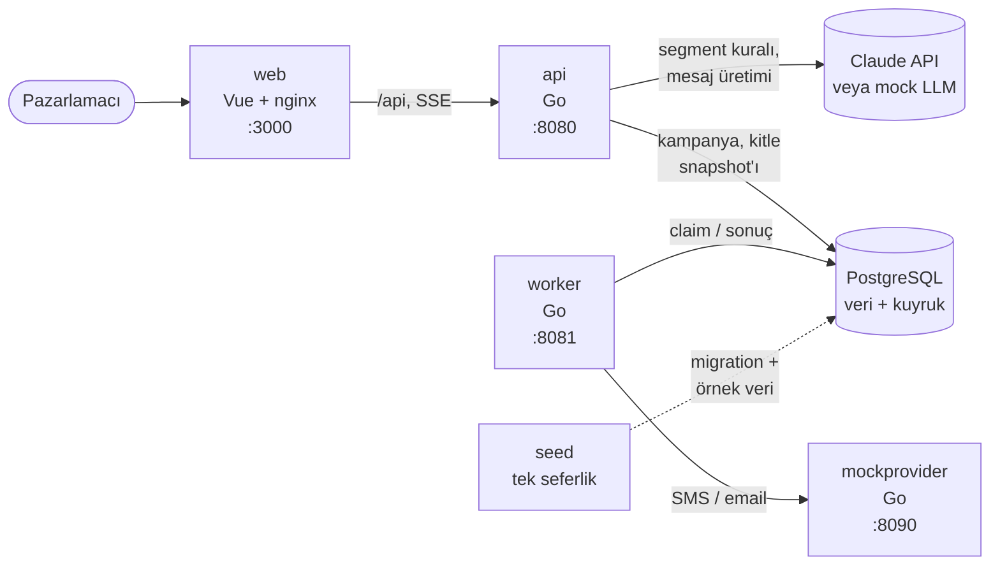

# Smart Campaign Composer

Pazarlamacı ne istediğini doğal dille yazar, örneğin:

> "Son 30 günde sepetine ürün ekleyip alışveriş yapmayan İstanbul'daki kullanıcılara
> %30 indirim hatırlatması gönder. Samimi ama kısa olsun."

Claude bu brief'ten bir hedef kitle kuralı ve SMS + email mesajları önerir. Pazarlamacı
kitleyi ve mesajları önizler, gerekirse düzenler ve onaylar; **son kararı insan verir**.
Onaylanan kampanya bir kuyruk üzerinden mock provider'a gönderilir ve canlı izlenir.
Gerçek kimseye mesaj gitmez: alıcılar sahte kullanıcılardır.

**Teknolojiler:** Go · Vue 3 + TypeScript + Vite · PostgreSQL (veritabanı ve kuyruk) ·
Claude API (`claude-sonnet-5-5`)

---

## Hızlı başlangıç

Yalnızca [Docker](https://docs.docker.com/get-docker/) (Compose v2 ile) gerekir.

```bash
git clone git@github.com:baychorov/Smart-Campaign-Composer.git
cd Smart-Campaign-Composer
docker compose up --build        # veya: make up
```

Arayüz: **http://localhost:3000**

İlk açılışta veritabanı şeması kurulur ve birkaç bin sahte kullanıcı yüklenir. Varsayılan
olarak **mock LLM** kullanılır: API key gerekmez, ücret oluşmaz. Mock modda arayüzde bir
rozet görünür.

```bash
make smoke                       # çalışan sisteme uçtan uca duman testi (ücretsiz)
make down                        # durdurur, veri korunur
docker compose down -v           # veriyi de siler; sonraki açılışta seed baştan yüklenir
```

### Gerçek Claude ile çalıştırma

```bash
cp .env.example .env
# .env içinde:
#   LLM_PROVIDER=anthropic
#   ANTHROPIC_API_KEY=<Claude Console'dan alınan key>
docker compose up --build
```

Key yalnızca `api` servisine verilir ve hiçbir loga yazılmaz. `.env` git'e ve Docker
imajlarına girmez.

> `docker compose config` komutu `.env`'deki değerleri açık metin yazdırır. Yapılandırmayı
> kontrol etmek için `docker compose config --quiet` kullanın.

---

## Mimari



| Servis | Görev |
|---|---|
| `web` | Vue uygulamasını sunar; `/api` isteklerini API'ye iletir (SSE tamponsuz). |
| `api` | Brief'ten kural çıkarır, kitleyi sayar, mesajları akış olarak üretir, onayı alır ve gönderim kuyruğunu yazar. Dashboard'a canlı durum akışı verir. |
| `worker` | Kuyruktaki gönderimleri alır; kanal başına hız limiti, retry ve backoff uygular. |
| `mockprovider` | Gerçek bir SMS/email servisini taklit eder: rastgele hata, gecikme ve 429 döndürür, saniyede 100 istek sınırı uygular. |
| `seed` | Migration'ları uygular ve sabit RNG seed'li örnek veriyi bir kez yükler, sonra kapanır. |
| `postgres` | Hem uygulama verisi hem kuyruk (`FOR UPDATE SKIP LOCKED`). Ayrı bir broker yok. |

### Akış

1. **Kitle:** Claude brief'ten yapılandırılmış bir segment kuralı (JSON) üretir. Kural
   backend'de doğrulanır, parametreli SQL'e derlenir; arayüz kanal başına kişi sayısını
   gösterir. Brief'te ifade edilemeyen kriterler (ör. "en az 3 sipariş") ayrıca listelenir
   ve pazarlamacının açık onayını gerektirir.
2. **İçerik:** SMS ve email metni ekrana akarak gelir. Karakter limitleri, değişkenler
   (`{{first_name}}`, `{{city}}`) kitledeki en uzun değerle doldurulmuş en kötü durum için
   kontrol edilir.
3. **Onay:** Pazarlamacı kanalları seçip onaylar. Kitle onay anında dondurulur
   (snapshot) ve gönderim kuyruğu aynı transaction'da yazılır.
4. **Gönderim ve izleme:** Worker mesajları mock provider'a gönderir; dashboard
   bekleyen, gönderilen, başarısız ve atlanan (izni geri çekilmiş) sayılarını canlı gösterir.
5. **Geçmiş kampanyalar:** `Kampanyalar` sayfası bütün kampanyaları en yeniden eskiye listeler
   (Tümü / Taslaklar / Gönderilenler). Satır açılınca brief, kitle, kanallar, gönderim sayıları
   ve mesajlar görünür. Taslaklar buradan silinebilir; onaylanmış kampanyalar silinemez.

### Temel güvenceler

- **LLM çıktısı SQL'e girmez.** Kolon adları koddaki sabit bir tablodan, değerler yalnızca
  SQL parametresi olarak gelir.
- **İzin filtresi her zaman eklenir.** Kanal izni kuralın parçası değildir; derleyici
  ekler, LLM veya kullanıcı kaldıramaz. Gönderimden hemen önce izin tekrar kontrol edilir.
- **Aynı kişiye aynı mesaj iki kez gitmez.** Atomik onay, `UNIQUE(campaign_id, user_id,
  channel)`, süreli kilit (lease) ve provider'a gönderilen idempotency anahtarı birlikte
  çalışır.
- **Kanal başına en fazla 100 mesaj/sn.** Worker varsayılan olarak 95/sn ile gönderir.
- **Karakterler rune ile sayılır** (Türkçe karakterler doğru sayılır): SMS ≤ 160,
  email konusu ≤ 80.
- **LLM yanıtı onaydan önce backend'de doğrulanır.** `refusal` veya `max_tokens` ile biten
  yanıtlar parse edilmez; geçersiz çıktı sınırlı sayıda onarım denemesine gider.
- **Kişisel veri (telefon, email) loglara ve metrik etiketlerine yazılmaz.**

### Portlar ve izleme

| Port | Servis | Faydalı adresler |
|---|---|---|
| 3000 | web | Arayüz |
| 8080 | api | `/healthz`, `/readyz`, `/metrics` |
| 8081 | worker | `/healthz`, `/readyz`, `/metrics` |
| 8090 | mockprovider | `/healthz`, `/stats` (teslim sayıları, en yüksek hız) |
| 5432 | postgres | kullanıcı/şifre/veritabanı: `scc` |

`/metrics` Prometheus formatındadır. `/healthz` sürecin ayakta olduğunu, `/readyz`
veritabanına erişilebildiğini gösterir.

---

## Testler

Testler gerçek API key olmadan çalışır. Katmanlar gerektirdikleri altyapıya göre ayrılır;
ağır ve ücretli testler Go build tag'leri (`integration`, `live`) arkasındadır, böylece
yanlışlıkla çalıştırılamaz.

| # | Katman | Kapsam | Gerektirir |
|---|---|---|---|
| 1 | Birim | Segment doğrulama ve SQL derleme, içerik kuralları, retry politikası, hız limiti | — |
| 2 | Entegrasyon | Gerçek Postgres: seed üzerinde kitle sayıları, unique kısıtlar, claim ve lease | Docker |
| 3 | LLM | Fake istemci ve sahte SSE sunucusu: bozuk JSON, onarım döngüsü, `max_tokens`, `refusal`, akış kopması | — |
| 4 | Uçtan uca gönderim | Worker + mock provider + Postgres: worker gönderim ortasında öldürülse de tam bir kez teslim, 1 sn'lik pencerede ≤ 100 istek | Docker |
| 5 | Canlı | Gerçek API ile adaptör kontratı (en fazla 2 çağrı) | API key, **ücretli** |

| Komut | Çalıştırdığı | Gerektirir |
|---|---|---|
| `make test-unit` | Katman 1 ve 3 | Go |
| `make test` | Katman 1–4 ve frontend testleri (Vitest) | Go, Node, Docker |
| `make lint` | `gofmt`, `go vet`, ESLint, `vue-tsc` | Go, Node |
| `make smoke` | Çalışan sisteme uçtan uca akış: brief → kural → içerik → onay → gönderim | Çalışan `make up`, mock LLM |
| `make test-live` | Katman 5 | API key, **ücretli** |

`make test` Postgres container'ını kendisi başlatır.

### Model değerlendirmesi (eval)

`docs/PLAN.md`'deki 20 brief'lik test seti (basit, karmaşık, belirsiz, desteklenmeyen ve
saldırı içeren brief'ler) gerçek modelle çalıştırılır. Puanlama kuralın yapısıyla değil,
sabit seed verisinde seçtiği kişi kümesinin beklenen kümeyle karşılaştırılmasıyla yapılır.
Doğruluk ve tutarlılık (aynı brief'in çalıştırmalar arasında aynı sonucu vermesi) ayrı
raporlanır.

```bash
make eval-dry                       # ideal yanıtlarla, API çağrısı yok (ücretsiz)
make eval RUNS=1 CASES=1,4,7        # küçük deneme (ücretli)
make eval                           # 20 brief × 3 çalıştırma (ücretli)
```

Eval API key gerektirir, çağrı bütçesini aşmaz ve raporu `eval/reports/` altına Markdown +
JSON olarak yazar.

**Son sonuç** (`claude-sonnet-5-5`, 60 çağrı, 2026-11-08): doğruluk **%93,3** (56/60),
tutarlılık **%95** (19/20). Kitle bekleyen bütün çalıştırmalarda seçilen kişiler beklenenle
birebir aynıydı; injection içeren brief üç kez de reddedildi. Rapor:
[`eval/reports/2026-11-08T1443-claude-sonnet-5-5.md`](eval/reports/2026-11-08T1443-claude-sonnet-5-5.md)

Dört hatanın dördü de zaman ifadelerinin (teklif mi, gönderim zamanı mı) sınıflandırmasıydı.
Prompt düzeltmesinden sonra bu iki brief (#2, #13) üçer kez yeniden çalıştırıldı: 6/6 doğru
([rapor](eval/reports/2026-11-08T1522-cases-2-13-claude-sonnet-5-5.md)). Tam eval düzeltmeden
sonra tekrarlanmadı.

---

## Yerel geliştirme

Gerekenler: **Go 1.27**, **Node 26**, **Docker**, **make**.

```bash
make db-up              # yalnızca Postgres
make seed               # migration + örnek veri (veri varsa atlar)
make seed-reset         # tabloları silip baştan yükler

cd backend
go run ./cmd/api            # :8080
go run ./cmd/mockprovider   # :8090
go run ./cmd/worker         # :8081

make frontend-dev       # Vite dev sunucusu :5173; /api istekleri :8080'e yönlenir
```

Yerelde çalışan binary'ler yapılandırmayı ortam değişkenlerinden veya `.env`'den okur.

### Yapılandırma

Bütün değişkenler isteğe bağlıdır; varsayılanlar ve açıklamalar için
[`.env.example`](.env.example). Docker Compose `.env`'den yalnızca `LLM_*`, `ANTHROPIC_*`,
`WORKER_*` ve `MOCK_*` değerlerini alır; servis adresleri compose dosyasında sabittir.

| Değişken | Varsayılan | Açıklama |
|---|---|---|
| `LLM_PROVIDER` | `mock` | `mock` veya `anthropic` |
| `LLM_MODEL` | `claude-sonnet-5-5` | Kullanılacak Claude modeli |
| `ANTHROPIC_API_KEY` | — | `LLM_PROVIDER=anthropic` için gerekli |
| `WORKER_SEND_RATE` | `95` | Kanal başına saniyede gönderim |
| `WORKER_CONCURRENCY` | `8` | Kanal başına eşzamanlı gönderim |
| `MOCK_ERROR_RATE` / `MOCK_429_RATE` | `0.05` / `0.03` | Mock provider'ın hata ve 429 oranları |
| `MOCK_RATE_LIMIT` | `100` | Mock provider'ın saniyelik istek sınırı |

---

## Proje yapısı

```
backend/
  cmd/             api, worker, mockprovider, seed, eval
  internal/        segment, content, llm, campaign, delivery, mockprovider,
                   httpapi, seed, eval, platform
  migrations/      SQL migration'ları (binary'ye gömülü)
frontend/          Vue 3 + TypeScript uygulaması, nginx yapılandırması
scripts/smoke.sh   make smoke
eval/reports/      eval raporları
docs/              CASE.md (gereksinimler), PLAN.md (uygulama planı, eval test seti)
ai-sessions/       Claude Code oturum kayıtları
DECISIONS.md       mimari kararlar ve gerekçeleri
```

---

## Kapsam ve bilinen sınırlar

- **Kimlik doğrulama yok;** tek kullanıcı varsayılır.
- **Tek `api` ve tek `worker` replikası** varsayılır. Hız limiti süreç içidir; mesaj
  üretim akışları API'nin belleğinde tutulur. Ölçek büyürse dağıtık limiter veya broker
  gerekir.
- **Desteklenmeyen kitle kriterleri:** sıra ("sepete ekledikten sonra"), sayı ve toplam
  ("en az 3 sipariş"), sıralama ("en çok harcayan 500"), ürün/kategori detayı, kesin tarih
  aralığı. Bunlar kurala girmez; pazarlamacıya açıkça listelenir.
- **Tüm kitle aynı mesajı alır;** gruba özel içerik yok.
- **SMS limiti karakter sayısıdır** (160). Türkçe karakter içeren gerçek bir SMS'te tek
  segment 70 karakterdir; bu fark uygulanmaz.
- **Email gövdesi düz metindir.**
- **"Son N gün" pencereleri** seed verisinin yüklendiği zamana göre kayar; aynı kural
  zamanla farklı sayılar verebilir. Onaylanan kampanyanın kitlesi onay anında sabitlenir.
- **Mock provider kayıtlarını bellekte tutar;** yeniden başlarsa istatistikleri sıfırlanır.
- **Manuel "tekrar gönder" yok;** deneme hakkı biten mesajlar `failed` kalır ve son hata
  dashboard'da görünür.

---

## Dokümanlar

- [`docs/CASE.md`](docs/CASE.md): gereksinimler
- [`docs/PLAN.md`](docs/PLAN.md): uygulama adımları, durumları ve eval test seti
- [`DECISIONS.md`](DECISIONS.md): kararlar ve gerekçeleri
- [`ai-sessions/`](ai-sessions/): Claude Code ile geliştirme oturumlarının kayıtları
