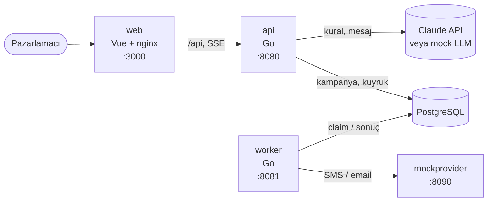

# Smart Campaign Composer

[](https://github.com/baychorov/Smart-Campaign-Composer/actions/workflows/ci.yml)

Pazarlamacı ne istediğini doğal dille yazar. Claude bundan bir hedef kitle ve SMS + email
mesajları önerir. Pazarlamacı önizler, düzenler ve onaylar. Kampanya kuyruk üzerinden mock
provider'a gönderilir ve canlı izlenir. Gerçek kimseye mesaj gitmez.

> "Son 30 günde sepetine ürün ekleyip alışveriş yapmayan İstanbul'daki kullanıcılara
> %30 indirim hatırlatması gönder. Samimi ama kısa olsun."

**Teknolojiler:** Go · Vue 3 + TypeScript · PostgreSQL · Claude API (`claude-sonnet-5-5`)

## Kurulum

Yalnızca Docker gerekir.

```bash
git clone git@github.com:baychorov/Smart-Campaign-Composer.git
cd Smart-Campaign-Composer
docker compose up --build
```

Arayüz: **http://localhost:3000**

Veritabanı, sahte kullanıcılar ve mock provider otomatik kurulur. Varsayılan olarak
**mock LLM** kullanılır: API key gerekmez, ücret oluşmaz.

**Gerçek Claude ile:**

```bash
cp .env.example .env
# .env içinde: LLM_PROVIDER=anthropic ve ANTHROPIC_API_KEY=<key>
docker compose up --build
```

**Durdurma:** `make down` (veri korunur), `docker compose down -v` (veri silinir).

## Mimari



| Servis | Görev |
|---|---|
| `web` | Arayüz; `/api` isteklerini API'ye iletir |
| `api` | Brief'ten kural ve mesaj üretir, onayı alır, kuyruğu yazar, canlı durumu yayınlar |
| `worker` | Kuyruktan mesajları alır; hız limiti ve retry uygular |
| `mockprovider` | Sahte SMS/email servisi; rastgele hata, gecikme ve 429 döndürür |
| `postgres` | Veri ve kuyruk (ayrı bir broker yok) |
| `seed` | Açılışta şemayı ve örnek veriyi yükler |

## Akış

1. **Kitle:** Claude brief'ten JSON bir kural üretir. Backend doğrular, kişi sayısı gösterilir.
2. **Mesaj:** SMS ve email metni ekrana akarak gelir; karakter limitleri kontrol edilir.
3. **Onay:** Pazarlamacı kanalları ve isterse gönderim zamanını seçip onaylar.
4. **Gönderim:** Worker mesajları gönderir, dashboard canlı gösterir. Başarısız kalanlar
   kampanya bitince tekrar gönderilebilir.
5. **Kampanyalar:** Geçmiş kampanyalar listelenir; taslaklar silinebilir.

## Temel güvenceler

- LLM çıktısı SQL'e girmez; değerler yalnızca SQL parametresi olur.
- Kanal izni olmayan kişiye mesaj gitmez; izin filtresini LLM veya kullanıcı kaldıramaz.
- Aynı kişiye aynı mesaj iki kez gitmez (worker çökse veya mesaj tekrar gönderilse de).
- Kanal başına saniyede en fazla 100 mesaj.
- SMS ≤ 160, email konusu ≤ 80 karakter; Türkçe karakterler doğru sayılır.
- Telefon, email ve API key loglara yazılmaz.

## Testler

Gerçek API key gerekmez (ücretli olanlar hariç).

| Komut | Ne test eder | Gerektirir |
|---|---|---|
| `make test-unit` | Kural doğrulama, SQL üretimi, mesaj kuralları, retry, LLM yanıtlarının işlenmesi | Go |
| `make test` | Yukarıdakiler + gerçek veritabanıyla kitle sayıları, kuyruk ve uçtan uca gönderim + arayüz testleri | Go, Node, Docker |
| `make lint` | Kod biçimi ve statik kontroller (Go ve frontend) | Go, Node |
| `make smoke` | Çalışan sistemde brief'ten gönderime tüm akış | Çalışan sistem, mock LLM |
| `make eval-dry` | Eval puanlamasının doğruluğu (ideal yanıtlarla, API çağrısı yok) | Go, Docker |
| `make test-live` | Gerçek Claude API ile bağlantı kontrolü (2 çağrı) | API key, **ücretli** |
| `make eval` | Gerçek modelle 25 brief × 3 çalıştırma, doğruluk raporu | API key, **ücretli** |

**Model değerlendirmesi:** Son tam eval'de doğruluk ve tutarlılık %100 (75/75). Rapor:
[`eval/reports/2026-11-09T1416-claude-sonnet-5-5.md`](eval/reports/2026-11-09T1416-claude-sonnet-5-5.md).
Zamanlanmış gönderim bu ölçümden sonra eklendi; ilgili iki brief ayrıca yeniden ölçüldü
(6/6, [`rapor`](eval/reports/2026-11-09T1457-cases-2-13-claude-sonnet-5-5.md)).

## Bonus özellikler

- **Zamanlanmış gönderim:** Brief'teki gönderim zamanı onay ekranına dolu gelir, değiştirilebilir ve gönderim başlayana kadar iptal edilebilir.
- **CI:** GitHub Actions her push ve pull request'te `make lint`, `make test` ve `make smoke` çalıştırır.

## Sınırlar

- Kimlik doğrulama yok; tek `api` ve tek `worker` varsayılır.
- Desteklenmeyen kitle kriterleri: harcama tutarı, sıralama ("en çok harcayan 500"),
  ürün/kategori, "en fazla N kez". Bunlar pazarlamacıya açıkça gösterilir.
- Tüm kitle aynı mesajı alır; email gövdesi düz metindir.
- SMS sınırı case'teki gibi 160 karakterdir. Gerçekte Türkçe karakterli bir SMS 70
  karakterde bölünür; gerekçe `DECISIONS.md` D-CONTENT'te.
- Zamanlanmış gönderim şu andan sonraki herhangi bir an ile 30 gün arasıdır; gönderim başladıktan sonra durdurulamaz.
- Mock provider kayıtlarını bellekte tutar; yeniden başlarsa istatistikleri sıfırlanır.
- Kullanıcının diline göre içerik yapılmadı; mesajlar Türkçe üretilir.

## Dokümanlar

- [`DECISIONS.md`](DECISIONS.md): kararlar ve gerekçeleri
- [`docs/PLAN.md`](docs/PLAN.md): uygulama adımları ve eval test seti
- [`docs/CASE.md`](docs/CASE.md): gereksinimler
- [`ai-sessions/`](ai-sessions/): Claude Code oturum kayıtları
